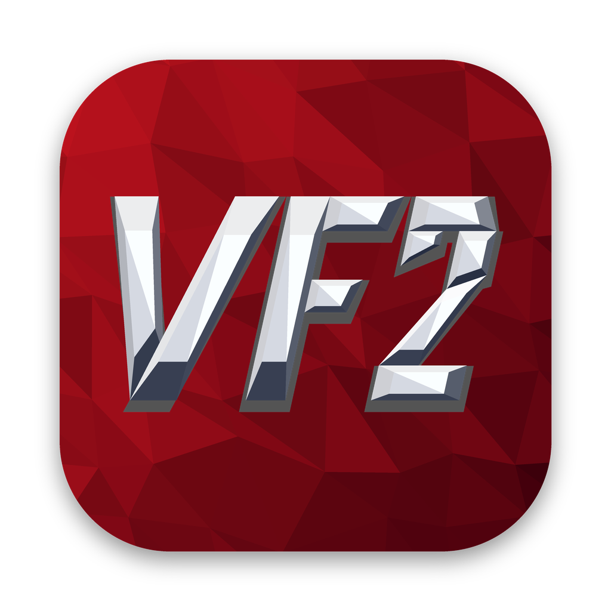

<p align="center"></p>

<h1 align="center">Virtua Fighter 2 Recomp</h1>

<p align="center"><b>Virtua Fighter 2 (SEGA, arcade, Model 2, 1994) as a native PC game: the game's own i960 program,
recompiled to native code, with render scales up to 6x, widescreen and smooth motion at any refresh rate.</b></p>

<p align="center">
  <a href="https://github.com/mr-finster/vf2-recomp/releases/latest"></a>
  <a href="LICENSE"></a>
  
</p>

<p align="center">
  <a href="https://vf2-recomp.pages.dev/">Play</a> ·
  <a href="https://github.com/mr-finster/vf2-recomp/releases/latest">Download</a> ·
  <a href="https://youtu.be/mpaUiJwlYu8">Trailer</a> ·
  <a href="#status">Status</a> ·
  <a href="#controls">Controls</a> ·
  <a href="https://github.com/mr-finster/vf2-recomp/issues">Report a bug</a>
</p>

> [!IMPORTANT]
> No game files are included: no ROMs and nothing made from them. You need your own dump of the game as MAME's
> `vf2` set (`vf2.zip`, Version 2.1). It is read on your computer, and the game's program is recompiled there each
> time it starts. An unofficial fan project, not made, approved or supported by SEGA, and not affiliated with it.

## About

Virtua Fighter 2 Recomp runs the game's own program, for the board's Intel i960 CPU, recompiled to native code
(ARM64 or x86-64) from your ROM each time it starts, and checked instruction for instruction, cycle for cycle
against MAME's i960 interpreter. Only the i960 program is recompiled: the rest of the Model 2A board (the TGP
geometry processor, the geometrizer and polygon renderer, the System 24 tile layers, and the sound board's 68000
and SCSP) runs on code from MAME, inside an SDL 3 host. At 1x you get the arcade's frames and sound as MAME makes
them (pixel for pixel on Apple silicon; on x86-64 a few texels a frame round differently, the renderer's
multiply-adds not fused); above it, render scales up to 6x, widescreen and ultrawide, and smooth motion at your
screen's refresh rate.

## Status

| Area | State |
| --- | --- |
| The i960 program, recompiled to native code | Working |
| TGP, geometrizer and renderer, tile layers, sound board | Working: they run on MAME's code |
| Render scale up to 6x, widescreen and ultrawide, smooth motion | Working |
| Menu, keyboard and gamepads, two players, the arcade's settings | Working |
| macOS, Windows, Linux / Steam Deck | Working |
| A GPU renderer for the 3D | Not yet: in progress |
| The GPU renderer on Windows and Steam Deck | Not yet |
| Online play | Not yet |

## Play

From the [latest release](https://github.com/mr-finster/vf2-recomp/releases/latest), or the
[site](https://vf2-recomp.pages.dev/):

| System | Download |
| --- | --- |
| macOS 11+ (Apple silicon and Intel) | `VirtuaFighter2Recomp-mac.zip` |
| Windows 10 or 11 (64-bit) | `VirtuaFighter2Recomp-windows.zip` |
| Linux / Steam Deck (x86-64) | `VirtuaFighter2Recomp-deck.tar.gz` |

**Mac and Windows**

1. Unzip it (Mac: move **Virtua Fighter 2 Recomp** to Applications; Windows: the VirtuaFighter2 folder anywhere, not inside Program Files).
2. Open it (Windows: `VirtuaFighter2.exe`).
3. Choose your `vf2.zip` when it asks. A copy is kept, so you only do this once.

**Steam Deck**

1. Copy the download to the Deck (e.g. Downloads) and unpack it there: in Desktop Mode, right-click it in the file
   manager > Extract > Extract archive here. (Unpacking on Windows, or copying the folder through a USB stick, can
   lose the files' permissions, and then nothing launches.)
2. Put your `vf2.zip` in the `VirtuaFighter2/roms` folder.
3. Desktop Mode: Steam > Games > Add a Non-Steam Game to My Library > Browse, set the file type filter to "All
   files", pick the `vf2` file in the VirtuaFighter2 folder, Add Selected Programs. In its Properties, set Start In
   to the VirtuaFighter2 folder (e.g. `/home/deck/Downloads/VirtuaFighter2/`), and under Compatibility leave "Force
   the use of a specific Steam Play compatibility tool" off: it's a native Linux game, and Proton stops it launching.
4. Back in Game Mode, launch it from your Library with the default Gamepad layout.

On another x86-64 Linux PC: unpack it anywhere, put `vf2.zip` in its `roms` folder and run `VirtuaFighter2.sh`.

> [!NOTE]
> The Mac and Windows builds aren't signed. On macOS, open it once, close the message, then System Settings >
> Privacy & Security > Open Anyway. On Windows, if SmartScreen warns, choose More info > Run anyway.

## Controls

Change them in the menu (<kbd>Esc</kbd>, or View / Select on a pad).

| Key | Does |
| --- | --- |
| <kbd>↑</kbd> <kbd>↓</kbd> <kbd>←</kbd> <kbd>→</kbd> | Player 1: move |
| <kbd>Z</kbd> <kbd>X</kbd> <kbd>C</kbd> | Player 1: guard, punch, kick |
| <kbd>1</kbd> | Player 1: start |
| <kbd>I</kbd> <kbd>J</kbd> <kbd>K</kbd> <kbd>L</kbd> | Player 2: move |
| <kbd>B</kbd> <kbd>N</kbd> <kbd>M</kbd> | Player 2: guard, punch, kick |
| <kbd>2</kbd> | Player 2: start |
| <kbd>Esc</kbd> | Menu: display, sound, game, arcade settings, controls, quit |
| <kbd>P</kbd> | Pause |
| <kbd>F3</kbd> | Reset |
| <kbd>F5</kbd> / <kbd>F6</kbd> | Render scale / picture shape |
| <kbd>F9</kbd> | Frame timings |
| <kbd>F11</kbd> | Fullscreen |
| <kbd>F12</kbd> | Screenshot |

Gamepad (Xbox layout): d-pad or stick to move, X guard, A punch, B kick, Y guard + punch (throws), RB punch + kick,
LB guard + kick, RT all three, Start to start. View (tap) opens the menu; View + LB / RB change the render scale /
picture shape.

## How it works

The recompiler (`src/rec`) finds the i960 program's code with an address map (`src/rec/vf2_map.cpp`: where the
functions start and where the indirect jumps lead, no bytes from the ROM), made from coverage runs, and turns it
into native code with SLJIT as the game starts. Around it, code from MAME runs the rest of the Model 2A board: the
TGP, the geometrizer and polygon renderer, the tile chip and the sound board's 68000 and SCSP. The SDL 3 host
composites the picture, scales and shapes it, and fills in the frames between the arcade's for smooth motion.

## Repository layout

| Path | Contents |
| --- | --- |
| `src/core` | the Fujitsu MB86233 (TGP) core, from MAME, and the shim MAME's CPU cores compile against |
| `src/rec` | the i960 recompiler: code discovery, native code (SLJIT) at start-up, the C++ build's, the runtime |
| `src/machine` | Model 2A: memory map, interrupts and timers, the TGP glue, geometrizer and renderer, the tile chip, the sound board, smooth motion |
| `src/host` | the SDL 3 host: window, input, pacing, scene sync, the GPU compositing, the RmlUi menu |
| `assets/` | the app icon, the menu (`ui/`) and its font, the player select's painted sides |
| `third_party/` | MAME's i960 and 68000 cores and more, SLJIT, RmlUi, stb_image |
| `tools/recomp` | the ahead-of-time recompiler (i960 to C++), for development |
| `tools/*.cpp` | the headless runner (`vf2run`), disassembler, ROM set check, lockstep checker (`vf2lock`) |
| `tools/*.py`, `tools/scripts` | comparisons with MAME's pictures, sound and traces; input scripts |
| `tools/mac`, `tools/win`, `tools/deck`, `tools/release` | the release packages and their licence notices |

## Run it yourself

Needs a C++20 compiler, zlib, SDL 3 and FreeType (Mac: `brew install sdl3 freetype`).

```
make                    # build/bin/vf2, and the headless tools
build/bin/vf2 path/to/vf2.zip
```

The release packages: `tools/mac/package.sh` (Mac), `tools/win/build.sh` (Windows, cross-compiled with MinGW-w64),
`tools/deck/build.sh` (Linux / Steam Deck: x86-64, in Valve's Steam Runtime "sniper" SDK container).
`tools/release/licenses.sh` gathers the third-party notices they carry.

`build/bin/vf2run` runs the board headless (pictures, RAM dumps, raw sound, an input script such as
`tools/scripts/start_game.txt`); `tools/compare.py` and `tools/sound_compare.py` compare its output with MAME's.
The address map is made from coverage runs (`vf2run --cov`, then `make map`). `make rec` also recompiles the
program to C++ (into `build/`, from your `roms/vf2.zip`: never committed) for `build/bin/vf2lock`, which runs the
interpreter and the recompiled code side by side and compares the CPU's whole state, the clocks, the RAMs and the
pictures as they go. `vf2 --interp` and `vf2run --interp` run the interpreter.

## How it's made

Made with the help of AI coding tools. Every build is checked against the arcade: the recompiled i960 program runs
side by side with MAME's interpreter, and the pictures, RAM and sound are compared frame by frame with MAME's.

The whole story, with how the AI-assisted work was organised and checked: [docs/HOW-IT-WAS-MADE.md](docs/HOW-IT-WAS-MADE.md).

## Credits

Built on MAME's work on the Model 2: the i960 core and disassembler (Farfetch'd, R. Belmont), the 68000 core and
the TGP (Olivier Galibert), the Model 2 driver and video (R. Belmont, Olivier Galibert, ElSemi, Angelo Salese,
Matthew Daniels), the System 24 tile chip (Olivier Galibert), the SCSP and its DSP (ElSemi, R. Belmont), the
polygon scan converter (Ville Linde, Aaron Giles) and more (`third_party/mame/README.md` lists every file and its
authors), all BSD-3-Clause. Also RmlUi (MIT), stb_image (Sean Barrett, public domain / MIT), SDL 3 (zlib),
FreeType (FreeType License), zlib, and the Barlow Condensed font (SIL Open Font License).

Virtua Fighter 2 is SEGA's. This project is not affiliated with or endorsed by SEGA.

## Licence

MIT for this project's own code: see [LICENSE](LICENSE). Code from MAME keeps its BSD-3-Clause licence and notices;
the rest of `third_party/` keeps its own, and the Barlow Condensed font the SIL Open Font License. The art, the
player select's painted sides (`assets/backgrounds/select.png`) and the app icon (`assets/icon/`, drawn by
`tools/release/make_icon.py`), is by Mr Finster under [CC BY 4.0](https://creativecommons.org/licenses/by/4.0/).

## Support

If you enjoy it, you can [buy me a coffee](https://buymeacoffee.com/mrfinster).
